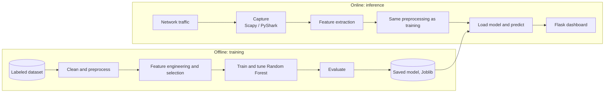
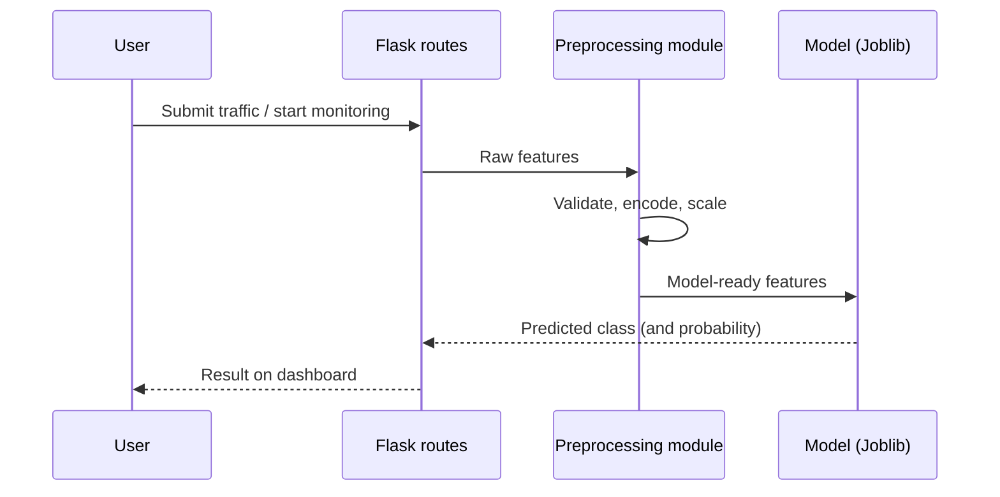
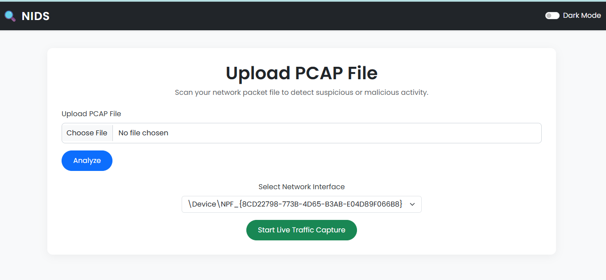
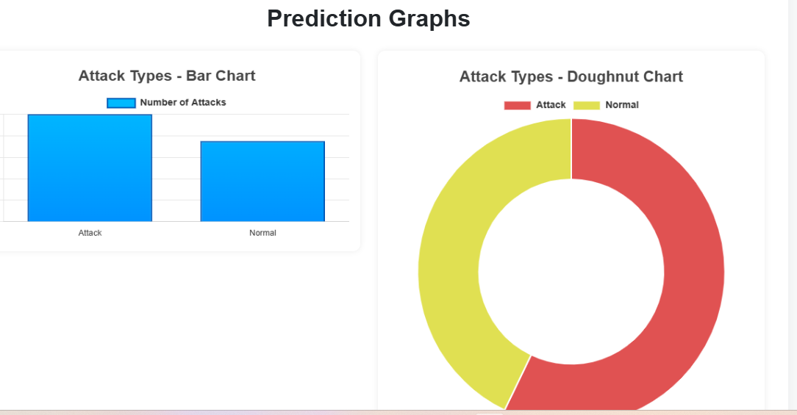
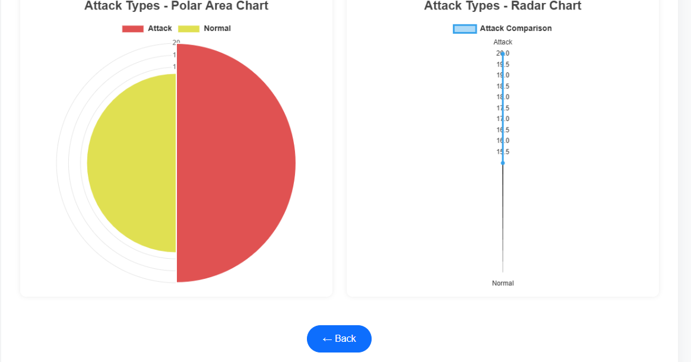
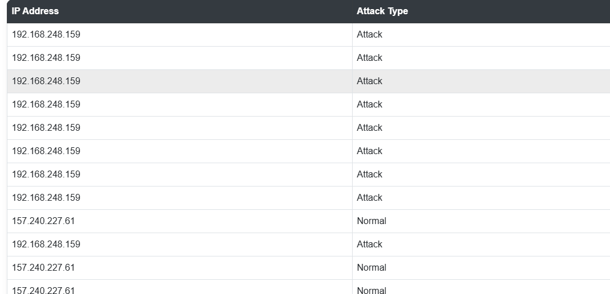

<div align="center">

# 🛡️ Network Intrusion Detection System (NIDS)

**An end-to-end ML system that detects malicious network traffic with a Random Forest classifier, packaged as a modular Flask application.**


<!-- Add once you set them up:


-->

</div>

---

## Table of Contents

- [At a Glance](#at-a-glance)
- [Problem Statement](#problem-statement)
- [System Design](#system-design)
- [Machine Learning](#machine-learning)
- [Software Engineering](#software-engineering)
- [Screenshots](#screenshots)
- [Tech Stack](#tech-stack)
- [Project Structure](#project-structure)
- [Getting Started](#getting-started)
- [Reproducing the Results](#reproducing-the-results)
- [Limitations](#limitations)
- [Roadmap](#roadmap)
- [Contributing](#contributing)
- [Disclaimer](#disclaimer)
- [Author](#author)

---

## At a Glance

| | |
| --- | --- |
| **Problem** | Detect malicious traffic that signature and rule-based tools miss |
| **Approach** | Feature extraction, preprocessing pipeline, Random Forest classifier |
| **Dataset** | `<DATASET NAME>`: `<N>` records, `<N>` features, `<N>` classes |
| **Best result** | `<XX.XX%>` accuracy, `<XX.XX%>` macro F1 |
| **Serving** | Flask dashboard with a persisted Joblib model |
| **Inference latency** | `<X ms>` per record (measured on `<hardware>`) |

> Status legend used in this README: ✅ implemented · 🚧 in progress · 📋 planned

---

## Problem Statement

Traditional intrusion detection relies on fixed signatures and hand-written rules. These fail against new attack variants and cannot scale with traffic volume. This project treats intrusion detection as a **supervised classification problem** over network flow features.

**Goals**

1. Classify each traffic record as normal or a specific attack category.
2. Keep recall high on attack classes, since a missed attack costs more than a false alarm.
3. Serve predictions through an interface that a security analyst can use.
4. Keep the pipeline reproducible, so the same input always gives the same output.

---

## System Design

### Two pipelines: offline training and online inference



### Request flow



### Design decisions

| Decision | Why | Trade-off |
| --- | --- | --- |
| **Random Forest** | Strong on tabular data, handles mixed feature types, resists overfitting, gives feature importances | Larger model size and slower than a linear model |
| **Joblib model persistence** | Train once, load at startup, no retraining per request | Model and code versions must stay in sync |
| **Shared preprocessing for train and inference** | Prevents training/serving skew | Preprocessing code becomes a hard dependency of the app |
| **Modular Flask layout** (routes separate from ML logic) | Easier to test and replace the model | Slightly more files for a small app |

---

## Machine Learning

### Pipeline

| Stage | What happens | Status |
| --- | --- | --- |
| Data cleaning | Handle missing values, duplicates, and wrong dtypes with Pandas | ✅ |
| Preprocessing | Encode categorical fields, scale numeric fields where needed | ✅ |
| Train/test split | `<80/20>`, stratified so class ratios are preserved | ✅ |
| Model training | `RandomForestClassifier` (Scikit-learn) | ✅ |
| Model persistence | Joblib serialization, loaded by the Flask app | ✅ |
| Cross-validation | Stratified k-fold to check stability | 📋 |
| Hyperparameter tuning | `RandomizedSearchCV` / `GridSearchCV` | 📋 |
| Class imbalance handling | `class_weight="balanced"` or SMOTE | 📋 |
| Explainability | Feature importance, optionally SHAP | 📋 |

### Core approach (simplified)

Keeping preprocessing and the model in a single `Pipeline` means the scaler is fit on training data only, which avoids **data leakage**, and the same transformations are applied at inference.

```python
from sklearn.compose import ColumnTransformer
from sklearn.ensemble import RandomForestClassifier
from sklearn.model_selection import train_test_split
from sklearn.pipeline import Pipeline
from sklearn.preprocessing import OneHotEncoder, StandardScaler
import joblib

preprocess = ColumnTransformer([
    ("num", StandardScaler(), numeric_cols),
    ("cat", OneHotEncoder(handle_unknown="ignore"), categorical_cols),
])

model = Pipeline([
    ("preprocess", preprocess),
    ("clf", RandomForestClassifier(
        n_estimators=200,
        class_weight="balanced",   # helps on imbalanced attack classes
        n_jobs=-1,
        random_state=42,           # reproducibility
    )),
])

X_train, X_test, y_train, y_test = train_test_split(
    X, y, test_size=0.2, stratify=y, random_state=42
)
model.fit(X_train, y_train)
joblib.dump(model, "models/nids_rf.joblib")
```

> Adapt this to match your actual training code, and keep only what your project really does.

### Evaluation

Accuracy alone is misleading on imbalanced intrusion data, so the model is judged on several metrics.

| Metric | Score |
| --- | --- |
| Accuracy | `XX.XX%` |
| Precision (macro) | `XX.XX%` |
| Recall (macro) | `XX.XX%` |
| F1-score (macro) | `XX.XX%` |
| ROC-AUC | `X.XXX` |
| False positive rate | `X.XX%` |

**Per-class results**

| Class | Precision | Recall | F1 | Support |
| --- | --- | --- | --- | --- |
| Normal | `-` | `-` | `-` | `-` |
| `<Attack type 1>` | `-` | `-` | `-` | `-` |
| `<Attack type 2>` | `-` | `-` | `-` | `-` |

**Model comparison** (optional but valuable)

| Model | Accuracy | Macro F1 | Training time | Inference time |
| --- | --- | --- | --- | --- |
| Logistic Regression (baseline) | `-` | `-` | `-` | `-` |
| Decision Tree | `-` | `-` | `-` | `-` |
| **Random Forest (chosen)** | `-` | `-` | `-` | `-` |

**Error analysis:** `<Which attack types are confused with which? Why do you think so? What would you try next?>`

---

## Software Engineering

### Engineering practices

| Area | Implementation | Status |
| --- | --- | --- |
| Modular architecture | Routes, preprocessing, and inference separated in `app/` | ✅ |
| Dependency management | `requirements.txt` with virtual environment | ✅ |
| Version control | Git workflow with `.gitignore` | ✅ |
| Reproducibility | Fixed `random_state`, pinned dependency versions | 🚧 |
| Configuration | Paths and settings through environment variables | 📋 |
| Logging | Python `logging` for predictions and errors | 📋 |
| Input validation | Reject malformed or missing features before prediction | 📋 |
| Testing | `pytest` unit tests for preprocessing and prediction | 📋 |
| CI | GitHub Actions: lint and test on every push | 📋 |
| Containerization | Dockerfile for one-command setup | 📋 |
| Code quality | `black`, `flake8` / `ruff` | 📋 |

### Planned API

| Method | Endpoint | Description |
| --- | --- | --- |
| `GET` | `/health` | Service and model status |
| `POST` | `/predict` | Classify one traffic record, returns label and probability |
| `POST` | `/predict/batch` | Classify a CSV of records |

### Performance

| Measure | Result |
| --- | --- |
| Model load time | `<X s>` |
| Single prediction latency | `<X ms>` |
| Batch throughput | `<X records/s>` |
| Model file size | `<X MB>` |

### Security considerations

- Live packet capture needs elevated privileges, so run it with least privilege and only on networks you are authorized to monitor.
- Validate and sanitize all inputs before they reach the model.
- Never commit datasets with sensitive traffic or secrets to the repo.

---

## Screenshots

### Monitoring dashboard


### Traffic analysis


### Model performance


### Prediction results


<!-- Strongly recommended additions: confusion matrix, feature importance plot, ROC curve -->

---

## Tech Stack

| Category | Tools |
| --- | --- |
| Language | Python |
| Backend | Flask |
| Machine learning | Scikit-learn (Random Forest), Joblib |
| Network analysis | Scapy, PyShark |
| Data processing | Pandas, NumPy |
| Visualization | Matplotlib, Seaborn |
| Tooling | Git, virtual environments |

---

## Project Structure

```text
Network_Intrusion_Detection_System/
├── app/
│   ├── routes.py          # Flask routes
│   └── modules/           # Preprocessing and inference logic
├── models/                # Trained model (.joblib)
├── dataset/               # Training and evaluation data
├── notebooks/             # (planned) EDA and experiments
├── tests/                 # (planned) pytest unit tests
├── screenshots/           # README images
├── static/
├── templates/
├── run.py                 # Application entry point
├── requirements.txt
├── .gitignore
└── README.md
```

---

## Getting Started

**Prerequisites:** Python 3.9+, `pip`. For live capture: administrator/root access and **Npcap** (Windows) or **libpcap** (Linux/macOS).

```bash
# Clone
git clone https://github.com/Chintucharan/Network_Intrusion_Detection_System.git
cd Network_Intrusion_Detection_System

# Virtual environment
python -m venv venv
venv\Scripts\activate          # Windows
source venv/bin/activate       # Linux / macOS

# Install and run
pip install -r requirements.txt
python run.py
```

Open **http://127.0.0.1:5000/**.

## Reproducing the Results

1. Download `<DATASET NAME>` from `<link>` and place it in `dataset/`.
2. Run the training notebook or script: `<notebook / script name>`.
3. The trained model is saved to `models/`.
4. Start the app with `python run.py`.

Random seeds are fixed (`random_state=42`), so metrics should match those reported above.

---

## Limitations

- Results depend on the dataset, and real-world traffic can differ from benchmark data.
- Intrusion datasets are usually **class-imbalanced**, so rare attack classes need separate attention.
- A supervised model detects known attack patterns better than novel ones (zero-day attacks).
- Model performance can degrade over time as traffic patterns drift, so periodic retraining is needed.

## Roadmap

- [ ] Stratified cross-validation and hyperparameter tuning
- [ ] Class imbalance handling and per-class reporting
- [ ] Compare with XGBoost, SVM, and a neural network
- [ ] SHAP-based explainability for each prediction
- [ ] REST API (`/predict`, `/health`)
- [ ] Unit tests with `pytest` and CI with GitHub Actions
- [ ] Docker containerization
- [ ] Real-time alerts (email or webhook)
- [ ] Drift monitoring and scheduled retraining
- [ ] Cloud deployment

## Contributing

1. Fork the repository
2. Create a branch: `git checkout -b feature/your-feature`
3. Commit your changes: `git commit -m "Add your feature"`
4. Push the branch: `git push origin feature/your-feature`
5. Open a Pull Request

## Disclaimer

For **educational and research purposes only**. Monitor only networks you own or have explicit permission to analyze.

## Author

**Gowni Venkat Charan**

[](https://github.com/Chintucharan)
[](https://www.linkedin.com/in/gowni-venkat-charan-1b06562a8/)

---

<div align="center">

If you found this project useful, consider giving it a ⭐

</div>
