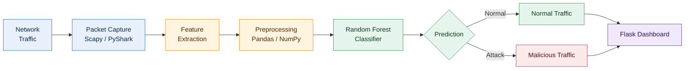
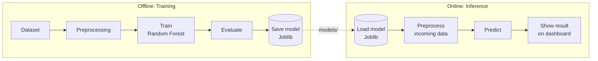
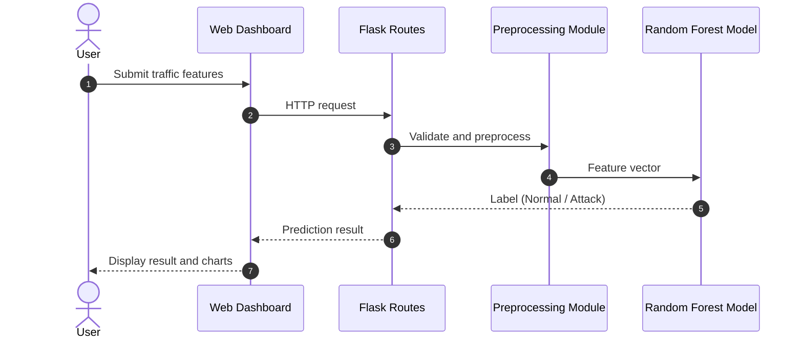

<div align="center">

# 🛡️ Network Intrusion Detection System

**Machine learning-based detection of malicious network traffic, powered by a Random Forest classifier and served through a Flask web dashboard.**


[Repository](https://github.com/Chintucharan/Network_Intrusion_Detection_System) ·
[Report a Bug](https://github.com/Chintucharan/Network_Intrusion_Detection_System/issues) ·
[Request a Feature](https://github.com/Chintucharan/Network_Intrusion_Detection_System/issues)

</div>

---

## Table of Contents

- [Overview](#overview)
- [Features](#features)
- [System Workflow](#system-workflow)
- [Why Random Forest](#why-random-forest)
- [Screenshots](#screenshots)
- [Tech Stack](#tech-stack)
- [Project Structure](#project-structure)
- [Getting Started](#getting-started)
- [Roadmap](#roadmap)
- [Disclaimer](#disclaimer)
- [Author](#author)

---

## Overview

Traditional rule-based monitoring struggles to keep pace with new and evolving cyber threats. This project applies machine learning to network traffic features and classifies each record as **normal** or **malicious**.

It demonstrates the complete lifecycle of an ML application: traffic analysis, data preprocessing, model training and persistence, real-time inference, and a web interface for exploring results.

## Features

| | Feature | Description |
| :-: | --- | --- |
| 📡 | **Traffic analysis** | Captures and inspects packets using Scapy and PyShark |
| 🧩 | **Feature extraction** | Converts raw traffic into model-ready features |
| 🌲 | **ML-based detection** | A trained Random Forest classifier labels every record |
| 💾 | **Model persistence** | The model is saved with Joblib and loaded at runtime, so no retraining is needed |
| 🖥️ | **Web dashboard** | A Flask interface displaying detection results and predictions |
| 📊 | **Visualization** | Matplotlib and Seaborn charts for traffic patterns and model behavior |

## System Workflow

### 1. End-to-end detection pipeline



### 2. Model lifecycle: train once, predict many times



### 3. Request flow



## Why Random Forest

- ✅ Performs well on **tabular, mixed-type network data**.
- ✅ Combines many decision trees, making it **less prone to overfitting** than a single tree.
- ✅ Exposes **feature importance**, showing which traffic attributes drive detection.
- ✅ Delivers **fast predictions**, which suits monitoring use cases.

## Screenshots

<table>
  <tr>
    <td align="center" width="50%">
      <b>Network Monitoring Dashboard</b><br/><br/>
      
    </td>
    <td align="center" width="50%">
      <b>Prediction Results</b><br/><br/>
      
    </td>
  </tr>
  <tr>
    <td align="center" width="50%">
      <b>Traffic Analysis</b><br/><br/>
      
    </td>
    <td align="center" width="50%">
      <b>Model Performance</b><br/><br/>
      
    </td>
  </tr>
</table>

## Tech Stack

| Category | Tools |
| --- | --- |
| **Language** | Python |
| **Backend** | Flask |
| **Machine Learning** | Scikit-learn (Random Forest), Joblib |
| **Network Analysis** | Scapy, PyShark |
| **Data Processing** | Pandas, NumPy |
| **Visualization** | Matplotlib, Seaborn |
| **Tooling** | Git, virtual environments |

## Project Structure

```text
Network_Intrusion_Detection_System/
├── app/
│   ├── routes.py          # Flask routes
│   └── modules/           # Preprocessing and prediction logic
├── models/                # Trained ML model
├── dataset/               # Dataset files
├── screenshots/           # README images
├── static/                # CSS, JS, assets
├── templates/             # HTML templates
├── run.py                 # Application entry point
├── requirements.txt
├── .gitignore
└── README.md
```

## Getting Started

### Prerequisites

- Python **3.9** or later
- For live packet capture: administrator/root access, plus **Npcap** (Windows) or **libpcap** (Linux/macOS)

### Installation

```bash
# 1. Clone the repository
git clone https://github.com/Chintucharan/Network_Intrusion_Detection_System.git
cd Network_Intrusion_Detection_System

# 2. Create and activate a virtual environment
python -m venv venv
venv\Scripts\activate          # Windows
source venv/bin/activate       # Linux / macOS

# 3. Install dependencies
pip install -r requirements.txt

# 4. Run the application
python run.py
```

Then open **http://127.0.0.1:5000/** in your browser.

## Roadmap

- [ ] Docker containerization
- [ ] REST API for predictions
- [ ] Real-time security alerts
- [ ] Comparison with other models (XGBoost, SVM, deep learning)
- [ ] Unit tests and CI/CD with GitHub Actions
- [ ] Cloud deployment

Have an idea? [Open an issue](https://github.com/Chintucharan/Network_Intrusion_Detection_System/issues).

## Disclaimer

This project is for **educational and research purposes only**. Use it only on networks you own or have explicit permission to monitor.

## Author

**Gowni Venkat Charan**

[](https://github.com/Chintucharan)
[](https://www.linkedin.com/in/gowni-venkat-charan-1b06562a8/)

**More projects:** 🎮 [Color Mania](https://github.com/Chintucharan/simongame), a memory sequence game ([Live Demo](https://chintucharan.github.io/simongame/))

---

<div align="center">

If you found this project useful, consider giving it a ⭐

</div>
