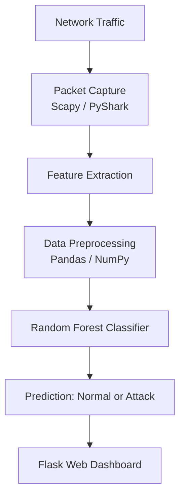

<div align="center">

# 🛡️ Network Intrusion Detection System (NIDS)

**A machine learning-based system that classifies network traffic as normal or malicious using a Random Forest classifier, with a Flask web interface.**


[Repository](https://github.com/Chintucharan/Network_Intrusion_Detection_System) · [Report a Bug](https://github.com/Chintucharan/Network_Intrusion_Detection_System/issues) · [Request a Feature](https://github.com/Chintucharan/Network_Intrusion_Detection_System/issues)

</div>

---

## Table of Contents

- [Overview](#overview)
- [Features](#features)
- [How It Works](#how-it-works)
- [Why Random Forest](#why-random-forest)
- [Screenshots](#screenshots)
- [Tech Stack](#tech-stack)
- [Project Structure](#project-structure)
- [Getting Started](#getting-started)
- [Future Enhancements](#future-enhancements)
- [Disclaimer](#disclaimer)
- [Author](#author)

---

## Overview

Traditional rule-based monitoring struggles to keep up with new and changing cyber threats. This project uses machine learning to analyze network traffic features and classify them as normal or suspicious.

It covers the full flow of an ML application: network traffic analysis, data preprocessing, model inference with a Random Forest classifier, and a Flask web interface for viewing the results.

## Features

- **Network traffic analysis:** captures and inspects packets with Scapy and PyShark.
- **Feature extraction:** turns raw traffic into features the model can use.
- **ML-based detection:** a trained Random Forest classifier labels each record.
- **Model persistence:** the trained model is saved with Joblib and loaded by the app, so no retraining is needed at runtime.
- **Web dashboard:** a Flask interface that shows detection results and predictions.
- **Data visualization:** charts built with Matplotlib and Seaborn to explore traffic patterns and model behavior.

## How It Works



1. Network traffic is captured and inspected.
2. Relevant features are extracted and preprocessed.
3. The trained Random Forest model classifies the traffic.
4. Results are shown on the web dashboard.

## Why Random Forest

- Works well on **tabular, mixed-type network data**.
- Combines many decision trees, which makes it **less prone to overfitting** than a single tree.
- Gives **feature importance**, which helps show which traffic attributes matter for detection.
- Makes predictions quickly, which suits monitoring use cases.

## Screenshots

### Network Monitoring Dashboard


### Traffic Analysis


### Model Performance


### Prediction Results


## Tech Stack

| Category | Tools |
| --- | --- |
| Language | Python |
| Backend | Flask |
| Machine Learning | Scikit-learn (Random Forest), Joblib |
| Network Analysis | Scapy, PyShark |
| Data Processing | Pandas, NumPy |
| Visualization | Matplotlib, Seaborn |
| Tools | Git, virtual environments |

## Project Structure

```text
Network_Intrusion_Detection_System/
├── app/
│   ├── routes.py        # Flask routes
│   └── modules/         # Preprocessing and prediction logic
├── models/              # Trained ML model
├── dataset/             # Dataset files
├── screenshots/         # README images
├── static/              # CSS, JS, assets
├── templates/           # HTML templates
├── run.py               # Application entry point
├── requirements.txt
├── .gitignore
└── README.md
```

## Getting Started

**Prerequisites:** Python 3.9 or later. For live packet capture you also need administrator or root access, plus Npcap (Windows) or libpcap (Linux/macOS).

```bash
# Clone the repository
git clone https://github.com/Chintucharan/Network_Intrusion_Detection_System.git
cd Network_Intrusion_Detection_System

# Create and activate a virtual environment
python -m venv venv
venv\Scripts\activate          # Windows
source venv/bin/activate       # Linux / macOS

# Install dependencies
pip install -r requirements.txt

# Run the application
python run.py
```

Then open **http://127.0.0.1:5000/** in your browser.

## Future Enhancements

- [ ] Docker containerization
- [ ] REST API for predictions
- [ ] Real-time security alerts
- [ ] Comparison with other models (XGBoost, SVM, deep learning)
- [ ] Unit tests and CI/CD with GitHub Actions
- [ ] Cloud deployment

## Disclaimer

This project is for **educational and research purposes only**. Use it only on networks you own or have permission to monitor.

## Author

**Gowni Venkat Charan**

[](https://github.com/Chintucharan)
[](https://www.linkedin.com/in/gowni-venkat-charan-1b06562a8/)

### More Projects

- 🎮 [Color Mania](https://github.com/Chintucharan/simongame): memory sequence game ([Live Demo](https://chintucharan.github.io/simongame/))

---

<div align="center">

If you found this project useful, consider giving it a ⭐

</div>
